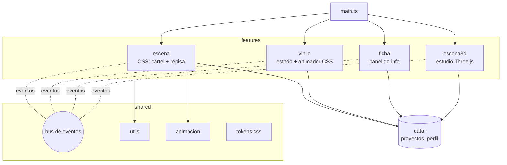
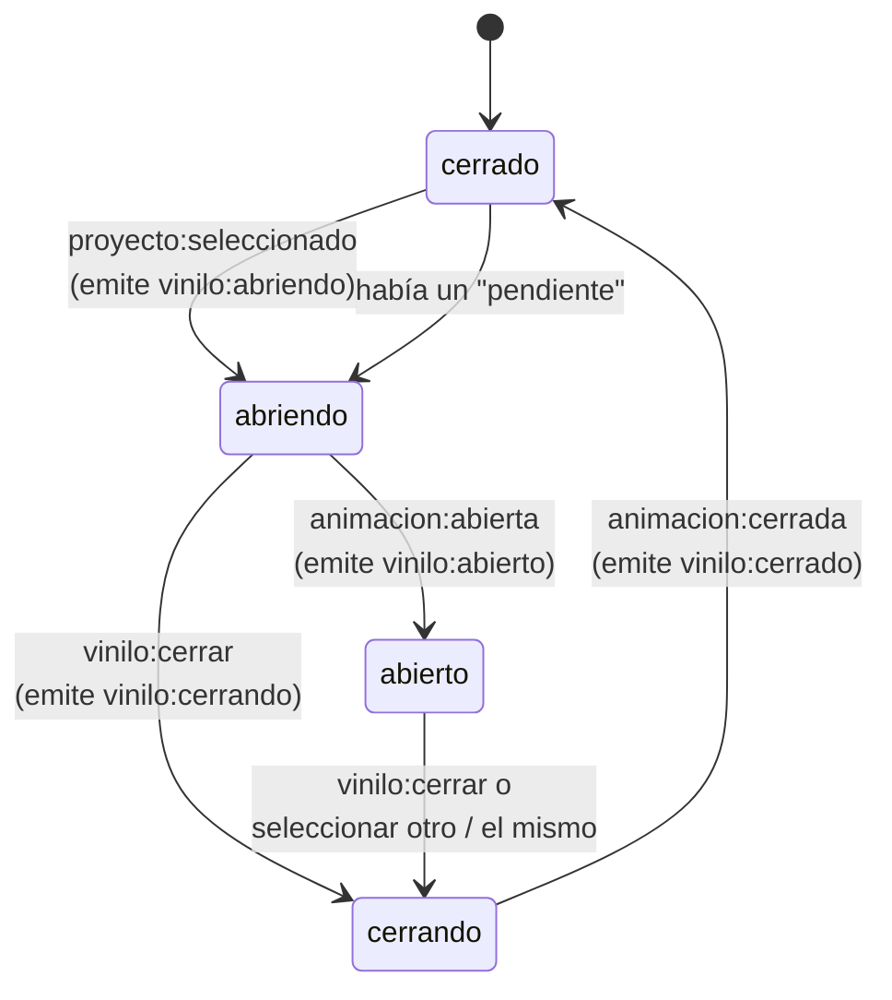
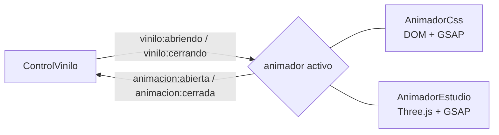
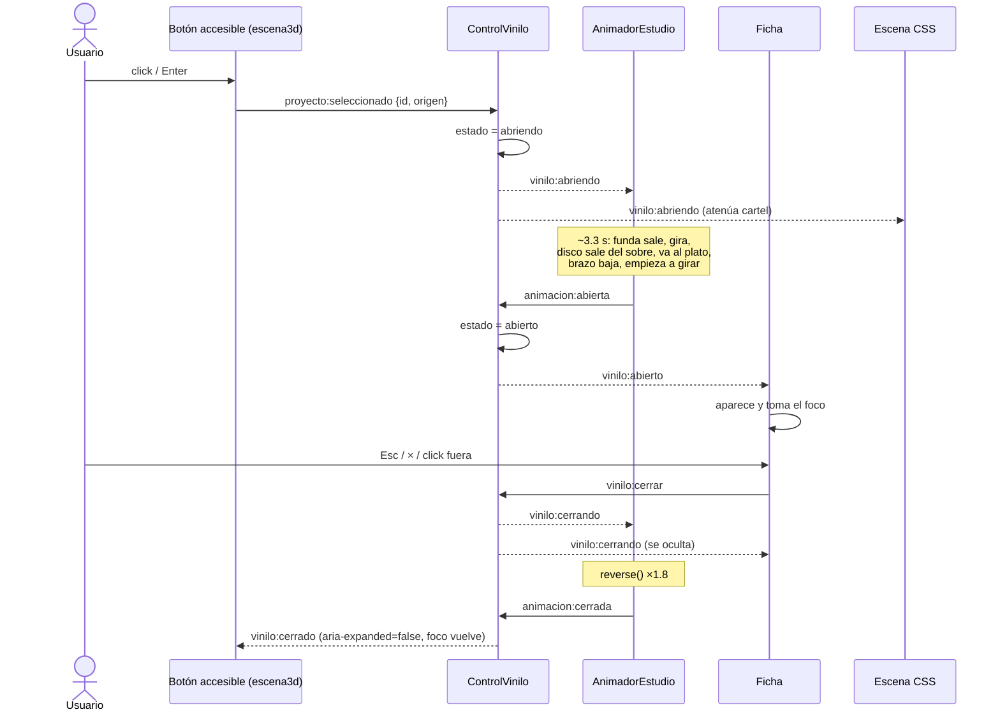
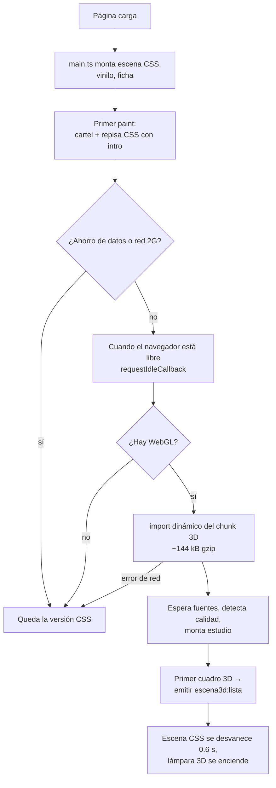
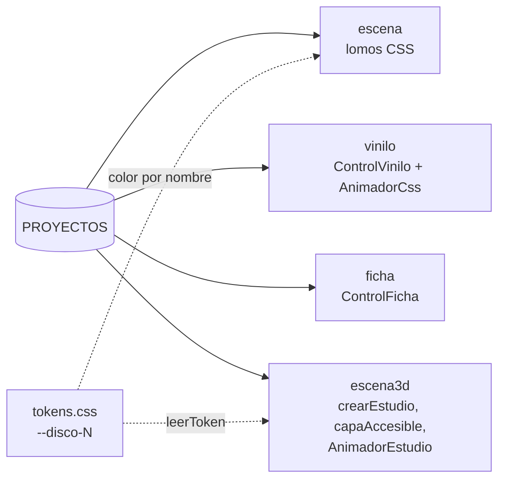
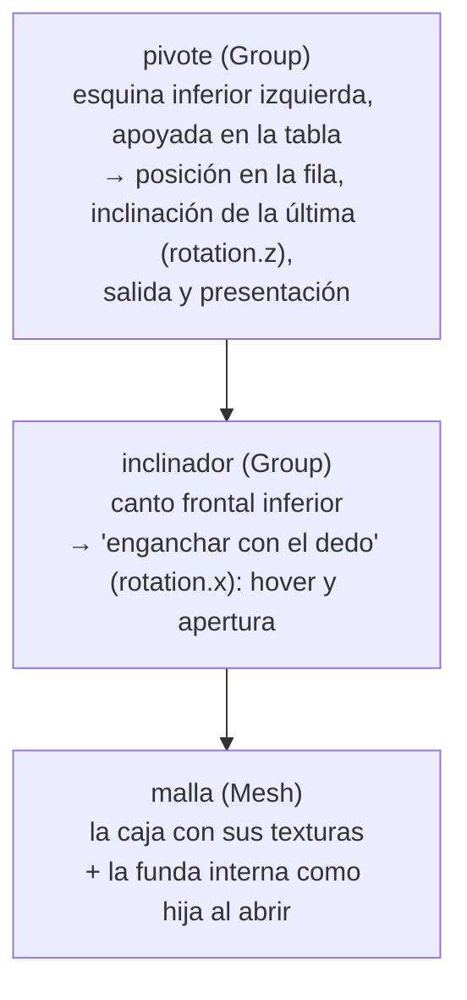
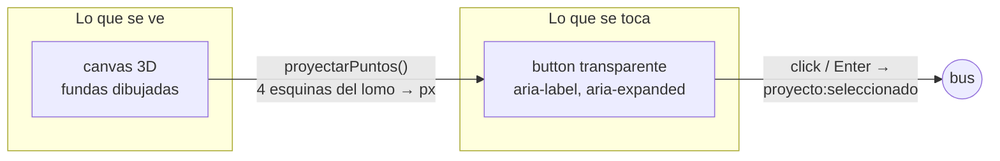

# Viniliando con joseesk — Documentación técnica

> Portafolio interactivo: un estudio oscuro con una repisa de discos de vinilo en 3D. Cada disco es un proyecto. Al elegirlo, la funda sale de la repisa, gira mostrando la portada, el vinilo sale del sobre, viaja a un tocadiscos, la aguja baja y aparece una ficha con la información del proyecto.

Este documento explica **qué hace cada parte del código, cómo se conectan y por qué está hecho así**. Está pensado para poder presentar el proyecto en una evaluación técnica.

---

## Índice

1. [Resumen en 30 segundos](#1-resumen-en-30-segundos)
2. [Stack y comandos](#2-stack-y-comandos)
3. [Mapa del repositorio](#3-mapa-del-repositorio)
4. [Arquitectura](#4-arquitectura)
   - 4.1 Principios · 4.2 Features y dependencias · 4.3 Bus de eventos · 4.4 Máquina de estados · 4.5 Dos animadores · 4.6 Secuencia completa de apertura · 4.7 Carga progresiva
5. [Carpeta por carpeta](#5-carpeta-por-carpeta)
   - 5.1 Raíz y configuración · 5.2 `src/main.ts` · 5.3 `src/shared` · 5.4 `src/data` · 5.5 `features/escena` · 5.6 `features/vinilo` · 5.7 `features/ficha` · 5.8 `features/escena3d`
6. [Accesibilidad](#6-accesibilidad)
7. [Rendimiento](#7-rendimiento)
8. [Calidad de código y tests](#8-calidad-de-código-y-tests)
9. [Decisiones de diseño y por qué](#9-decisiones-de-diseño-y-por-qué)
10. [Bugs encontrados y lecciones](#10-bugs-encontrados-y-lecciones)
11. [Cómo extender](#11-cómo-extender)
12. [Guion para explicarlo (5–10 min)](#12-guion-para-explicarlo-510-min)

---

## 1. Resumen en 30 segundos

- **Vanilla TypeScript + Vite**, sin framework. **GSAP** para todas las animaciones, **Three.js** para la escena 3D.
- El código está organizado en **features** (escena, vinilo, ficha, escena3d) que **no se importan entre sí**: se comunican por un **bus de eventos tipado**.
- Hay **una sola máquina de estados** (`ControlVinilo`) que decide si un disco está cerrado, abriéndose, abierto o cerrándose. **No anima nada**: avisa por eventos y espera que el animador activo confirme.
- Existen **dos animadores intercambiables** con el mismo contrato: uno **CSS** (versión liviana, placeholder mientras carga el 3D y respaldo sin WebGL) y uno **3D**.
- El 3D se carga **en diferido** (después del primer paint) y adapta su **calidad** al dispositivo y a la red. Todas las texturas se **generan por código**: no se descarga ninguna imagen.
- La **accesibilidad** se resuelve con **botones DOM reales** alineados sobre cada funda 3D: teclado, foco, lectores de pantalla y `aria-expanded` funcionan igual que en una web normal.

---

## 2. Stack y comandos

| Herramienta                              | Uso                                                                                                |
| ---------------------------------------- | -------------------------------------------------------------------------------------------------- |
| **Vite 8**                               | Servidor de desarrollo y build (separa el 3D en un chunk aparte)                                   |
| **TypeScript 6** (strict)                | Tipado estricto: `strict`, `noUncheckedIndexedAccess`, `noImplicitReturns`, `verbatimModuleSyntax` |
| **GSAP 3**                               | Timelines, tweens, `matchMedia`                                                                    |
| **Three.js 0.186**                       | Escena 3D (renderer WebGL, luces, materiales PBR)                                                  |
| **ESLint + typescript-eslint + sonarjs** | Reglas de estilo, tamaño y duplicación                                                             |
| **Prettier**                             | Formato                                                                                            |
| **Vitest + jsdom**                       | Tests de funciones puras y datos                                                                   |

| Comando             | Qué hace                    |
| ------------------- | --------------------------- |
| `npm run dev`       | Servidor local              |
| `npm run build`     | `tsc` + build de producción |
| `npm run preview`   | Sirve el build              |
| `npm run typecheck` | Chequeo de tipos            |
| `npm run lint`      | ESLint                      |
| `npm run format`    | Prettier                    |
| `npm run test`      | Vitest                      |

**Peso del build:** inicial ≈ **33 kB gzip** (JS) + 3 kB (CSS). El chunk 3D (`montarEscena3d-*.js`, incluye Three.js) ≈ **144 kB gzip**, cargado en diferido.

---

## 3. Mapa del repositorio

```
index.html                 → HTML mínimo: fuentes, favicon, <div id="app">
vite.config.ts             → build (umbral de chunk) + config de Vitest
tsconfig.json              → TypeScript estricto
eslint.config.js           → reglas de calidad (tamaños, duplicados, exports)
public/
  favicon.svg              → vinilo
  covers/                  → portadas (1.jpg … N.jpg) — opcionales
src/
  main.ts                  → arranca las 4 features. Sin lógica.
  data/
    proyectos.ts           → los proyectos (contenido)
    perfil.ts              → nombre, rol, contacto
    proyectos.test.ts      → valida los datos
  shared/                  → código compartido. No importa nada de features/ ni data/
    eventos.ts             → bus de eventos tipado
    types/                 → Proyecto, Perfil, mapa de eventos
    utils/                 → DOM, aleatorio con semilla, dispositivo, funciones (+ tests)
    animacion/             → constantes de GSAP, media queries, re-export de gsap
    estilos/               → tokens.css (diseño) y base.css (reset + botón)
  features/
    escena/                → versión CSS: cartel + repisa con lomos (placeholder / respaldo)
    vinilo/                → máquina de estados + animador CSS del disco
    ficha/                 → panel con la info del proyecto
    escena3d/              → estudio 3D (Three.js): repisa, fundas, tocadiscos, cámara,
                             capa accesible y animador 3D
```

Cada feature expone su API **solo** desde su `index.ts` y carga su propio CSS desde ahí.

---

## 4. Arquitectura

### 4.1 Principios

1. **Features aisladas.** Ninguna feature importa a otra. Si la escena necesita reaccionar a algo del vinilo, lo hace escuchando un evento.
2. **Un solo dueño del estado.** `ControlVinilo` es el único que sabe si hay un disco abierto. Todos los demás reaccionan a sus eventos.
3. **El estado no conoce la animación.** El control dice "abriendo" y espera "animación abierta". Quién anima (CSS o 3D) es intercambiable.
4. **`shared/` es neutral.** No importa nada de `features/` ni de `data/`: son herramientas genéricas.
5. **Datos como tokens.** Los datos guardan el _nombre_ de un color (`'disco-3'`), nunca un hex. Los colores viven en `tokens.css`, y el 3D los lee de ahí con `leerToken()`.
6. **Progresivo.** Primero funciona todo en CSS; el 3D se suma después si el dispositivo lo permite.

### 4.2 Features y dependencias



Las líneas punteadas son la **única** forma en que las features se hablan.

### 4.3 Bus de eventos

`src/shared/eventos.ts` implementa un publicador/suscriptor **tipado**. El mapa de eventos (`EventosApp` en `shared/types/eventos.ts`) define el nombre y la forma del payload de cada evento. TypeScript **no compila** si se emite un evento inexistente o con un payload incorrecto.

| Evento                  | Emite                                                      | Escucha                                                                    | Payload          | Significado                                                            |
| ----------------------- | ---------------------------------------------------------- | -------------------------------------------------------------------------- | ---------------- | ---------------------------------------------------------------------- |
| `proyecto:seleccionado` | escena (lomo CSS), escena3d (botón accesible)              | vinilo (control)                                                           | `{ id, origen }` | El usuario eligió un disco. `origen` = rectángulo en pantalla del lomo |
| `vinilo:abriendo`       | vinilo (control)                                           | escena, ficha, vinilo (animador CSS), escena3d (animador 3D, capa, cámara) | `{ id, origen }` | Empieza la apertura                                                    |
| `animacion:abierta`     | animador activo (CSS o 3D)                                 | vinilo (control)                                                           | `{ id }`         | La animación de apertura terminó                                       |
| `vinilo:abierto`        | vinilo (control)                                           | ficha                                                                      | `{ id }`         | El disco quedó abierto (la ficha toma el foco)                         |
| `vinilo:cerrar`         | ficha (×, Esc, click fuera), vinilo (cambio de breakpoint) | vinilo (control)                                                           | —                | Pedido de cerrar                                                       |
| `vinilo:cerrando`       | vinilo (control)                                           | escena, ficha, animadores                                                  | `{ id }`         | Empieza el cierre                                                      |
| `animacion:cerrada`     | animador activo                                            | vinilo (control)                                                           | `{ id }`         | La animación de cierre terminó                                         |
| `vinilo:cerrado`        | vinilo (control)                                           | escena, escena3d (capa, cámara)                                            | `{ id }`         | Cerrado del todo (foco vuelve al lomo)                                 |
| `escena3d:lista`        | escena3d                                                   | escena, ficha, vinilo (animador CSS)                                       | —                | El 3D dibujó su primer cuadro: la versión CSS cede su lugar            |

**Funciones del bus**

| Función           | Firma                               | Qué hace                                                                                                                                                    |
| ----------------- | ----------------------------------- | ----------------------------------------------------------------------------------------------------------------------------------------------------------- |
| `escuchar`        | `(nombre, manejador) => () => void` | Suscribe y **devuelve la función para desuscribirse**                                                                                                       |
| `dejarDeEscuchar` | `(nombre, manejador) => void`       | Desuscribe                                                                                                                                                  |
| `emitir`          | `(nombre, ...payload) => void`      | Llama a todos los manejadores. Si el evento no tiene payload, se emite sin segundo argumento (`emitir('vinilo:cerrar')`) gracias al tipo `ArgumentosEvento` |

Detalle de implementación: `emitir` recorre una **copia** de los manejadores, porque un manejador puede suscribirse o desuscribirse mientras se recorre la lista.

### 4.4 Máquina de estados

`ControlVinilo` (en `features/vinilo/estadoVinilo.ts`) tiene cuatro estados:



Reglas importantes:

- **Clicks durante una animación se ignoran** (`abriendo` o `cerrando`), así no se cruzan estados.
- **Mismo disco abierto** → se cierra (toggle). **Otro disco** → se guarda como `pendiente`, se cierra el actual y al confirmar el cierre se abre el pendiente.
- **Confirmaciones tardías o de otro id se descartan** (por ejemplo, un `animacion:abierta` que llega después de pedir cerrar).
- **Un id que no existe se ignora**: si no, el estado quedaría esperando una animación que nadie va a hacer.

### 4.5 Dos animadores, un contrato



- **`AnimadorCss`** (`features/vinilo/animadorCss.ts`): anima una funda y un disco hechos con DOM/CSS. Está activo al cargar la página.
- **`AnimadorEstudio`** (`features/escena3d/animadorEstudio.ts`): anima los objetos 3D.
- Cuando llega `escena3d:lista`, el animador CSS **se retira**. Si justo tenía un disco abierto, primero lo cierra y se desconecta recién cuando terminó de cerrarlo, para que el estado no quede colgado.

Ambos usan el mismo patrón: **abrir = `play()` y cerrar = `reverse()` del mismo timeline**, y ambos resuelven el caso borde de `reverse()` en tiempo 0 (ver [Bugs](#10-bugs-encontrados-y-lecciones)).

### 4.6 Secuencia completa de apertura (modo 3D)



**La animación 3D paso a paso** (un único timeline reversible de ~3.3 s):

| Tiempo     | Qué pasa                                                                        | Dónde                               |
| ---------- | ------------------------------------------------------------------------------- | ----------------------------------- |
| 0–0.35 s   | El "dedo" engancha la funda: se inclina hacia la cámara sobre su canto frontal  | `animarSacarDisco.ts`               |
| 0.25–0.9 s | Sale de la fila (adelante y arriba) y se endereza                               | `animarSacarDisco.ts`               |
| 0.65–1.4 s | Gira 90° mostrando la portada y queda "en la mano"                              | `animarSacarDisco.ts`               |
| 0.3–1.4 s  | La cámara baja y se acerca                                                      | `camara.ts`                         |
| 1.4–1.8 s  | Sale la funda interna de papel (con agujero)                                    | `animarTocadiscos.ts`               |
| 1.7–2.15 s | El disco sale de la funda interna                                               | `animarTocadiscos.ts`               |
| 2.1–2.6 s  | La funda se deja a un lado                                                      | `animarTocadiscos.ts`               |
| 2.1–2.9 s  | El disco viaja al plato acostándose y baja al eje; la cámara pasa al tocadiscos | `animarTocadiscos.ts` + `camara.ts` |
| 2.75–3.3 s | El brazo se levanta, va al borde del disco y baja la aguja                      | `animarTocadiscos.ts`               |
| 3.15 s → ∞ | Plato y disco giran a 33⅓ rpm (tween **aparte**, infinito)                      | `animarTocadiscos.ts`               |

### 4.7 Carga progresiva



---

## 5. Carpeta por carpeta

### 5.1 Raíz y configuración

| Archivo              | Rol                                                                                                                                                                                                                                                            |
| -------------------- | -------------------------------------------------------------------------------------------------------------------------------------------------------------------------------------------------------------------------------------------------------------- |
| `index.html`         | `lang="es"`, título, favicon, fuentes de Google (Archivo Black + Space Grotesk), `<div id="app">` y el script `src/main.ts`                                                                                                                                    |
| `vite.config.ts`     | `build.chunkSizeWarningLimit: 600` (el chunk 3D es grande a propósito y se carga diferido). Configura Vitest: entorno `jsdom`, tests `src/**/*.test.ts`                                                                                                        |
| `tsconfig.json`      | Estricto: `strict`, `noUncheckedIndexedAccess` (acceder a un array devuelve `T \| undefined`), `noImplicitReturns`, `noUnusedLocals/Parameters`, `verbatimModuleSyntax` (obliga a `import type`), `erasableSyntaxOnly` (prohíbe `enum` y parameter properties) |
| `eslint.config.js`   | Reglas propias del proyecto (ver [§8](#8-calidad-de-código-y-tests))                                                                                                                                                                                           |
| `public/favicon.svg` | Vinilo en SVG. Usa colores fijos porque un favicon no puede leer `tokens.css`                                                                                                                                                                                  |

### 5.2 `src/main.ts`

Solo arranca y conecta. **No tiene lógica.**

```ts
const app = obtenerElemento('#app');
iniciarEscena(app); // versión CSS (visible de inmediato)
iniciarVinilo(app); // máquina de estados + animador CSS
iniciarFicha(app); // panel de información
iniciarEscena3d(app); // decide si cargar el 3D y lo hace en diferido
```

El orden importa: primero lo que se ve en el primer paint, al final el 3D.

### 5.3 `src/shared`

#### `shared/types/`

| Tipo                                                        | Archivo       | Descripción                                                                                                                                           |
| ----------------------------------------------------------- | ------------- | ----------------------------------------------------------------------------------------------------------------------------------------------------- |
| `Proyecto`                                                  | `proyecto.ts` | `id, numero, titulo, anio, color, descripcion, portada, captura, enlace` (todo `readonly`)                                                            |
| `ColorLomo`                                                 | `proyecto.ts` | Unión `'disco-1' \| … \| 'disco-10'`: nombres de token, nunca hex                                                                                     |
| `Perfil`, `EnlacePerfil`                                    | `perfil.ts`   | Nombre, rol, email, lista de enlaces                                                                                                                  |
| `EventosApp`                                                | `eventos.ts`  | Mapa nombre de evento → payload (`undefined` = sin payload)                                                                                           |
| `PayloadProyecto`, `PayloadSeleccion`, `Rectangulo`         | `eventos.ts`  | Payloads. `Rectangulo` es un **dato** (x, y, ancho, alto), no un nodo DOM: así una feature puede decirle a otra "desde dónde" sin compartir elementos |
| `NombreEvento`, `ManejadorEvento<N>`, `ArgumentosEvento<N>` | `eventos.ts`  | Tipos derivados. `ArgumentosEvento` es un tipo condicional: `[]` si el payload es `undefined`, `[payload]` si no                                      |

#### `shared/eventos.ts`

Ver [§4.3](#43-bus-de-eventos). El registro interno es un objeto `{ [nombre]: Set<manejador> }` tipado con un _mapped type_; `obtenerManejadores` crea el `Set` la primera vez.

#### `shared/utils/` (exportado desde `utils/index.ts`)

| Función                  | Archivo          | Firma                                                                                | Qué hace y por qué                                                                                                                                                                                                                                                                            |
| ------------------------ | ---------------- | ------------------------------------------------------------------------------------ | --------------------------------------------------------------------------------------------------------------------------------------------------------------------------------------------------------------------------------------------------------------------------------------------- |
| `crearElemento`          | `dom.ts`         | `(etiqueta, { clases, atributos, texto, hijos }) => HTMLElementTagNameMap[etiqueta]` | **Único** lugar del proyecto que llama a `document.createElement` (ESLint lo prohíbe en el resto). El tipo de retorno sale de la etiqueta (`'button'` → `HTMLButtonElement`). Los textos se agregan como nodos de texto: **nunca** se interpreta HTML, no hay `innerHTML` en todo el proyecto |
| `obtenerElemento`        | `dom.ts`         | `<T>(selector, padre = document) => T`                                               | `querySelector` que **lanza error** si no encuentra: un nodo faltante es un bug, no un caso a tolerar                                                                                                                                                                                         |
| `leerToken`              | `dom.ts`         | `(nombre) => string`                                                                 | Lee una variable CSS de `:root` (p. ej. `--disco-3` → `#3a86ff`). Así el 3D usa los mismos colores que el CSS sin duplicarlos. Lanza error si el token no existe                                                                                                                              |
| `devolverFocoSiSePerdio` | `dom.ts`         | `(elemento) => void`                                                                 | Enfoca el elemento **solo** si el foco está en `body` (se "perdió"). Si el usuario ya está en otro control, no se lo roba                                                                                                                                                                     |
| `crearAleatorio`         | `aleatorio.ts`   | `(semilla) => () => number`                                                          | Generador pseudoaleatorio **mulberry32** con semilla. Determinista: la madera, la pared y el acomodo de las fundas salen **iguales en cada visita**                                                                                                                                           |
| `entre`                  | `aleatorio.ts`   | `(azar, min, max) => number`                                                         | Valor en un rango usando un generador                                                                                                                                                                                                                                                         |
| `clasificarCalidad`      | `dispositivo.ts` | `(senales) => 'alta' \| 'baja'`                                                      | Móvil, < 4 GB, < 4 núcleos o red ≤ 3G → `baja`. Ante la duda, `baja`                                                                                                                                                                                                                          |
| `debeCargar3d`           | `dispositivo.ts` | `(senales) => boolean`                                                               | `false` con "ahorro de datos" o red 2G                                                                                                                                                                                                                                                        |
| `esRedLenta`             | `dispositivo.ts` | `(senales) => boolean`                                                               | Usada por `clasificarCalidad` (exportada para test)                                                                                                                                                                                                                                           |
| `combinarDesconexiones`  | `funciones.ts`   | `(fns[]) => () => void`                                                              | Junta varias funciones de limpieza (las que devuelve `escuchar`) en una                                                                                                                                                                                                                       |
| `crearImagen`            | `dom.ts`         | `(src, { clases, alt, ancho, alto, perezosa }) => HTMLImageElement`                  | `` con `width`/`height` (reserva espacio: sin saltos de layout) que **se quita sola si falla** (sin ícono de imagen rota). La usan la funda/etiqueta CSS y la captura de la ficha                                                                                                        |
| `precargarImagen`        | `dom.ts`         | `(src) => void`                                                                      | Crea un `` sin insertarlo: el navegador la descarga y queda en caché para cuando se muestre                                                                                                                                                                                              |
| `obtenerDominio`         | `url.ts`         | `(url) => string`                                                                    | `https://www.ejemplo.com/a` → `ejemplo.com`. Vacío si la URL no es válida. Usa `try/catch` y no `URL.canParse` (no existe en Safari < 17)                                                                                                                                                     |

Todas son **puras o casi puras** y tienen tests (`*.test.ts` al lado).

#### `shared/animacion/` (exportado desde `animacion/index.ts`)

- **Re-exporta `gsap`**: las features importan GSAP desde acá, así hay un único lugar para registrar plugins.
- **Constantes** (en segundos, la unidad de GSAP):

| Constante                                                   | Valor                                                    | Uso                                                                                           |
| ----------------------------------------------------------- | -------------------------------------------------------- | --------------------------------------------------------------------------------------------- |
| `DURACION_INTRO`                                            | 0.9                                                      | Intros CSS y 3D                                                                               |
| `DURACION_APERTURA`                                         | 1                                                        | Apertura CSS                                                                                  |
| `DURACION_FUNDA`                                            | 0.55                                                     | Primera parte de la apertura CSS (compartida entre escena y vinilo para que se muevan juntas) |
| `DURACION_FICHA` / `RETRASO_FICHA`                          | 0.5 / 0.3                                                | Entrada de la ficha                                                                           |
| `DURACION_VUELTA_DISCO`                                     | 1.8                                                      | Una vuelta a 33⅓ rpm (60/33.3)                                                                |
| `STAGGER_LOMOS`                                             | 0.12                                                     | Escalonamiento de las intros                                                                  |
| `EASE_ENTRADA` / `EASE_VINILO` / `EASE_CAIDA` / `EASE_GIRO` | `power3.out` / `power2.inOut` / `back.out(1.6)` / `none` | `none` en el giro: con aceleración se notaría un tirón en cada vuelta                         |
| `MEDIA_MOVIL`                                               | `(max-width: 767px)`                                     | Debe coincidir con los `@media` de los CSS                                                    |

- **Funciones:** `prefiereMenosMovimiento()` y `esMovil()`, que consultan `matchMedia` en el momento (comparten un helper interno `coincideMedia`).

#### `shared/estilos/`

- **`tokens.css`**: la **única** fuente de colores, fuentes, espacios, sombras y duraciones. Grupos: base (papel, tinta), 10 colores de disco, bordes y sombras del estilo neobrutal (versión CSS), vinilo, estudio 3D (pared, luz, nogal, metal, fieltro, surcos, cartón, papel interno), cartel/placa, tipografía y espacios.
- **`base.css`**: reset mínimo, `body`, títulos, y el **botón compartido** `.boton` (neobrutal) con su variante `.boton--texto` (enlace subrayado, usada en el modo 3D). También el contorno de foco global y la regla de movimiento reducido (transiciones a ~0).

### 5.4 `src/data`

`data/` es el **contenido** del portafolio: qué proyectos hay y quién es el autor. **No tiene lógica ni funciones**: solo constantes tipadas. Para cambiar lo que muestra la página (agregar un disco, cambiar un texto, el email) se edita **solo** esta carpeta; ninguna feature tiene textos de contenido escritos a mano.

| Archivo             | Exporta                                                   | Contenido                                                                                                                 |
| ------------------- | --------------------------------------------------------- | ------------------------------------------------------------------------------------------------------------------------- |
| `proyectos.ts`      | `PROYECTOS: readonly Proyecto[]`, `MAXIMO_PROYECTOS = 10` | La lista de discos de la repisa (hoy 7)                                                                                   |
| `perfil.ts`         | `PERFIL: Perfil`                                          | Nombre, rol, email y enlaces del cartel                                                                                   |
| `proyectos.test.ts` | —                                                         | Valida: entre 1 y 10 proyectos, ids únicos, números de 1 a N sin huecos, un color distinto por proyecto, textos no vacíos |

#### Por qué los datos están separados

- **Una sola fuente de verdad.** La versión CSS, el estudio 3D, el vinilo y la ficha leen la **misma** lista. Agregar un proyecto lo hace aparecer en la repisa CSS, en la repisa 3D, en los botones accesibles y en la ficha, sin tocar código de features.
- **Los tipos viven en `shared/types/`, los datos en `data/`.** `shared/` no puede importar `data/` (regla de dependencias), pero `data/` sí importa los tipos de `shared/`. Así las features conocen la _forma_ (`Proyecto`) sin depender del _contenido_.
- **Todo es de solo lectura.** Las interfaces marcan cada campo `readonly` y la lista es `readonly Proyecto[]`: TypeScript no compila un `PROYECTOS.push(...)` ni un `proyecto.titulo = ...` en ninguna feature. El contenido no cambia en tiempo de ejecución.
- **Sin `as const`, con anotación de tipo.** `PROYECTOS` se anota como `readonly Proyecto[]` en vez de inferirse: si falta un campo o un color no existe (`'disco-11'`), el error aparece **en el dato**, no en la feature que lo usa.

#### `proyectos.ts`

```ts
import type { Proyecto } from '../shared/types/proyecto';

export const MAXIMO_PROYECTOS = 10;

export const PROYECTOS: readonly Proyecto[] = [
  {
    id: 'mapa-sonoro',
    numero: 1,
    titulo: 'Mapa sonoro',
    anio: 2026,
    color: 'disco-1',
    descripcion: 'Mapa interactivo que reproduce sonidos grabados en distintos barrios.',
    portada: '/covers/1.jpg',
    enlace: 'https://example.com/mapa-sonoro',
  },
  // …
];
```

- `import type`: solo se importa el tipo, que desaparece al compilar (lo exige `verbatimModuleSyntax`).
- `MAXIMO_PROYECTOS` no es un número mágico: es el límite real del diseño. La paleta tiene 10 colores (`--disco-1` … `--disco-10`), la unión `ColorLomo` tiene 10 valores y la repisa 3D y el layout móvil están medidos para 10 fundas. El test lo usa para validar la cantidad.

**Cada campo y dónde se usa:**

| Campo         | Tipo        | Para qué sirve                                                                                         | Dónde se usa                                                                                                                                                                                                |
| ------------- | ----------- | ------------------------------------------------------------------------------------------------------ | ----------------------------------------------------------------------------------------------------------------------------------------------------------------------------------------------------------- |
| `id`          | `string`    | Identificador interno. Viaja en **todos** los eventos (`proyecto:seleccionado`, `vinilo:abriendo`…)    | `data-id` de lomos y botones 3D, `ControlVinilo` (valida que exista), animadores y ficha lo buscan con `PROYECTOS.find(...)`, `name` de la malla 3D                                                         |
| `numero`      | `number`    | Número visible del disco (1…N) y **semilla** del azar                                                  | Lomo CSS, funda CSS, ficha, `aria-label` ("3. Huerta urbana"), etiqueta del disco 3D. En 3D `numero × 7/13/31` es la semilla de las texturas: cada disco sale distinto pero **siempre igual** entre visitas |
| `titulo`      | `string`    | Nombre del proyecto                                                                                    | Lomo, funda, `h2` de la ficha, `aria-label`, textura del lomo y de la etiqueta 3D (en mayúsculas)                                                                                                           |
| `anio`        | `number`    | Año (sin `ñ` en el identificador, por la regla de nombres)                                             | Cabecera de la ficha                                                                                                                                                                                        |
| `color`       | `ColorLomo` | **Nombre** de un token, nunca un hex                                                                   | CSS: `style="--color-lomo: var(--disco-3)"`. 3D: `leerToken('--disco-3')` lee el hex de `tokens.css`. Así el color se cambia en **un solo lugar**                                                           |
| `descripcion` | `string`    | Texto corto                                                                                            | Cuerpo de la ficha                                                                                                                                                                                          |
| `portada`     | `string`    | Arte **cuadrado** de la funda: ruta en `public/` (`/covers/N.jpg`) o URL externa (en 3D necesita CORS) | Funda CSS (`` que se quita si falla) y 3D (`aplicarPortada`, se pide **solo al abrir**). Si no existe, queda la portada pintada por código                                                             |
| `captura`     | `string`    | Pantallazo **horizontal** de la web (cualquier URL; ideal 16:10)                                       | Ficha: ventana de navegador en escritorio, miniatura en móvil. En 3D se precarga en `vinilo:abriendo`                                                                                                       |
| `enlace`      | `string`    | URL externa del proyecto                                                                               | Botón "Ver proyecto →" de la ficha, con `target="_blank"` y `rel="noopener noreferrer"`                                                                                                                     |



#### `perfil.ts`

```ts
export const PERFIL: Perfil = {
  nombre: 'Nombre Apellido',
  rol: 'Diseño y desarrollo web',
  email: 'hola@example.com',
  enlaces: [
    { etiqueta: 'GitHub', url: 'https://github.com/' },
    { etiqueta: 'LinkedIn', url: 'https://www.linkedin.com/' },
  ],
};
```

Lo consume **solo** `features/escena` (`construirEscena` → `crearCartel`):

| Campo     | Se muestra como                                                                 |
| --------- | ------------------------------------------------------------------------------- |
| `nombre`  | El **único `h1`** de la página                                                  |
| `rol`     | Subtítulo del cartel                                                            |
| `email`   | Enlace `mailto:` dentro de `<address>`                                          |
| `enlaces` | Un enlace por elemento (`etiqueta` = texto, `url` = destino), en el mismo orden |

`enlaces` es `readonly EnlacePerfil[]`: se pueden agregar o quitar redes sin tocar código. En modo 3D el cartel sigue visible (como papel con cinta), así que estos datos se ven en las dos versiones.

#### `proyectos.test.ts`

Los datos los escribe una persona a mano, así que se validan como cualquier otra entrada. TypeScript ya garantiza la **forma** (campos y tipos); el test cubre las reglas que el tipo no puede expresar:

| Test                                      | Cómo lo comprueba                                                                     | Qué rompería si falla                                                                                     |
| ----------------------------------------- | ------------------------------------------------------------------------------------- | --------------------------------------------------------------------------------------------------------- |
| Entre 1 y `MAXIMO_PROYECTOS` proyectos    | `length >= 1` y `<= MAXIMO_PROYECTOS`                                                 | Con 0, repisa vacía. Con más de 10, no hay color ni lugar en la repisa                                    |
| `id` únicos                               | Un `Set` de ids debe tener el mismo tamaño que la lista                               | `PROYECTOS.find(id)` devolvería siempre el primero: se abriría otro disco y la ficha mostraría otro texto |
| `numero` de 1 a N sin huecos ni repetidos | Ordena los números y los compara con `[1, 2, …, N]`                                   | Numeración visible incoherente y semillas de textura repetidas                                            |
| Un `color` distinto por proyecto          | Un `Set` de colores con el mismo tamaño que la lista                                  | Dos discos iguales en la repisa                                                                           |
| Sin textos vacíos                         | `id`, `titulo`, `descripcion`, `portada`, `captura`, `enlace` con `trim().length > 0` | Lomos sin título, ficha vacía, enlace roto                                                                |

`perfil.ts` no tiene test: es un único objeto y su forma ya la garantiza el tipo `Perfil`.

#### Convenciones al editar los datos

- **`id` en _kebab-case_**, en minúsculas y sin espacios ni tildes (`'huerta-urbana'`). Hoy no se usa en selectores CSS, pero viaja en eventos y atributos `data-id`; un formato estable evita sorpresas si mañana se usa en una URL o un selector.
- **`numero` consecutivo** y **`color` = `disco-<numero>`**: así el test pasa y cada disco toma el color de su posición.
- **`portada`** apunta a `public/covers/<numero>.jpg`. Es opcional en la práctica: si el archivo no existe, se ve la portada generada por código.
- **Textos sin espacios al final** (`trim`): un espacio sobrante se nota en el lomo y en el `aria-label`.
- La repisa, la paleta (`--disco-1` … `--disco-10`) y el layout móvil están pensados para **hasta 10** proyectos. Para pasar de 10 habría que sumar tokens de color, ampliar `ColorLomo` y subir `MAXIMO_PROYECTOS`.

### 5.5 `features/escena` — versión CSS (placeholder y respaldo)

Es lo primero que se ve. Cuando el 3D está listo queda **solo el cartel** (el nombre y contacto); la repisa CSS se desvanece.

| Archivo              | Funciones                            | Qué hace                                                                                                                                                                                                                                                                                                                                              |
| -------------------- | ------------------------------------ | ----------------------------------------------------------------------------------------------------------------------------------------------------------------------------------------------------------------------------------------------------------------------------------------------------------------------------------------------------- |
| `index.ts`           | `iniciarEscena(contenedor)`          | Construye la escena, arranca la intro, conecta selección y estado. Al recibir `escena3d:lista` agrega `.escena--sobre-3d` y pasa los enlaces del cartel a `.boton--texto`                                                                                                                                                                             |
| `construirEscena.ts` | `construirEscena(proyectos, perfil)` | `<main>` con el cartel y la repisa (`<nav aria-label="Proyectos">` con los lomos + tabla decorativa `aria-hidden`)                                                                                                                                                                                                                                    |
| `crearCartel.ts`     | `crearCartel(perfil)`                | `<header>` con el **único `h1`** (nombre), rol y `<address>` con email y enlaces. Los externos abren con `rel="noopener noreferrer"`                                                                                                                                                                                                                  |
| `crearLomo.ts`       | `crearLomo(proyecto)`                | Un `<button>` por proyecto. Al click calcula su rectángulo y emite `proyecto:seleccionado`. **Tres capas, un transform cada una**: el `<button>` lo mueven intro y selección, `.lomo__cuerpo` el hover, `.lomo__frente` la inclinación estática                                                                                                       |
| `intro.ts`           | `animarIntro(escena)`                | Tabla se despliega (`scaleX`), lomos caen con `back.out`, cartel baja girando. `stagger.amount` fijo: con 10 lomos sigue < 2 s. Movimiento reducido: solo fundido. Se llama **en la misma tarea** que el `append`: los `from()` aplican el estado inicial antes del primer paint (sin parpadeo). Al terminar, `clearProps` devuelve el control al CSS |
| `animarSeleccion.ts` | `conectarSeleccion(escena, intro)`   | Reacciona a `vinilo:abriendo/cerrando`: el lomo elegido sube y se desvanece, los demás y el cartel se atenúan. Si se abre durante la intro, `intro.progress(1)` (si no, el `clearProps` final de la intro borraría la animación)                                                                                                                      |
| `marcarSeleccion.ts` | `conectarEstadoLomos(escena)`        | `aria-expanded` del lomo y foco de vuelta al cerrar                                                                                                                                                                                                                                                                                                   |
| `lomos.ts`           | `obtenerLomos`, `buscarLomo`         | Búsqueda de lomos por `data-id`                                                                                                                                                                                                                                                                                                                       |
| `constantes.ts`      | `PROPIEDADES_ANIMADAS`               | `'transform,opacity,visibility'` para `clearProps`                                                                                                                                                                                                                                                                                                    |
| `escena.css`         | —                                    | Repisa neobrutal, lomos, hover con sombra como capa (`::after` con opacidad), cartel; en `.escena--sobre-3d`: fondo transparente, repisa oculta con fundido, cartel como **papel con cinta**; layout móvil                                                                                                                                            |

### 5.6 `features/vinilo` — estado y animador CSS

| Archivo           | Funciones                                                | Qué hace                                                                                                                                                                                                                                    |
| ----------------- | -------------------------------------------------------- | ------------------------------------------------------------------------------------------------------------------------------------------------------------------------------------------------------------------------------------------- |
| `index.ts`        | `iniciarVinilo(contenedor)`                              | Monta el escenario (capa fija `aria-hidden`), conecta el control y el animador CSS. `cerrarAlCambiarLayout()` usa `gsap.matchMedia()` para **cerrar** el disco si se cruza el breakpoint móvil (las animaciones se calculan para un layout) |
| `estadoVinilo.ts` | `conectarControlVinilo()` + clase `ControlVinilo`        | La máquina de estados (ver [§4.4](#44-máquina-de-estados)). Métodos: `seleccionar`, `cerrar`, `confirmarApertura`, `confirmarCierre`, y privados `abrir`, `abrirPendiente`                                                                  |
| `animadorCss.ts`  | `conectarAnimadorCss(escenario)` + clase `AnimadorCss`   | `abrir` (monta el conjunto, crea la apertura, play), `cerrar` (reverse o cierre directo en t=0), `retirar` (al llegar el 3D), privados `terminarCierre` y `descartar`                                                                       |
| `abrirVinilo.ts`  | `crearApertura(piezas, avisos)`, `iniciarGiro(conjunto)` | Timeline CSS: la funda hace **FLIP** desde el rectángulo del lomo (sale de canto a `rotationY: 80` y gira a frente), luego el disco se desliza fuera. `calcularDesdeOrigen` calcula el FLIP. El giro es un tween aparte                     |
| `crearVinilo.ts`  | `crearVinilo(proyecto)`                                  | DOM del conjunto: disco (surcos con `repeating-radial-gradient`, brillo con `conic-gradient` fuera del disco para que no gire) + funda con número, título y portada. Si la portada falla se quita el `` (evita el ícono roto)          |
| `vinilo.css`      | —                                                        | Estilos del conjunto; velo en móvil que **captura los toques** (para que no caigan en un lomo de abajo)                                                                                                                                     |

### 5.7 `features/ficha` — panel de información

| Archivo           | Funciones                                          | Qué hace                                                                                                                                                                                                                                                                                                                                         |
| ----------------- | -------------------------------------------------- | ------------------------------------------------------------------------------------------------------------------------------------------------------------------------------------------------------------------------------------------------------------------------------------------------------------------------------------------------ |
| `index.ts`        | `iniciarFicha(contenedor)`                         | Conecta el control de la ficha                                                                                                                                                                                                                                                                                                                   |
| `controlFicha.ts` | `conectarFicha(contenedor)` + clase `ControlFicha` | Dos **modos**: `css` (entra en `vinilo:abriendo` con 0.3 s de retraso) y `3d` (entra en `vinilo:abierto`, cuando el disco ya gira; pasa a este modo con `escena3d:lista`). En 3D agrega `.ficha--impresa` y botones de texto. `mostrar`, `enfocar`, `ocultar`, `quitar`                                                                          |
| `crearFicha.ts`   | `crearFicha(proyecto)`                             | `<aside aria-labelledby>` con `tabindex="-1"` (enfocable por código, no por Tab), cabecera (número, año, ×) y cuerpo (captura, título `h2`, descripción, enlace "Ver proyecto →"). `crearCaptura` arma un `<figure>` con barra de navegador decorativa (`aria-hidden`: puntos + dominio de `enlace`) y la imagen con `alt="Captura de <título>"` |
| `cerrarFicha.ts`  | `conectarCierre(ficha)`                            | × , `Esc` y click fuera emiten `vinilo:cerrar`. Un click en cualquier disparador `[aria-expanded]` **no** cuenta como "fuera". Devuelve la función que quita los listeners                                                                                                                                                                       |
| `ficha.css`       | —                                                  | Versión neobrutal y versión **"liner notes"** (papel, franja del color del disco, año en versalitas)                                                                                                                                                                                                                                             |

Detalles finos:

- La ficha se hace **visible de forma sincrónica** (`gsap.set(visibility)`) y solo se anima la opacidad: si estuviera `hidden` al llamar `focus()`, el navegador no la enfocaría.
- Al empezar a ocultarse **suelta el foco** (`blur`): así, al llegar `vinilo:cerrado`, el foco está "perdido" y vuelve al lomo aunque la ficha todavía se esté desvaneciendo.

**Captura de la web en la ficha:**

```
Escritorio                        Móvil
┌──────────────────────────┐      ┌──────────────────────────────┐
│ 7  2025               ×  │      │ 7  2025                   ×  │
├──────────────────────────┤      ├──────────────────────────────┤
│ ┌──────────────────────┐ │      │ ┌──────┐ AVANZA-GESTIÓN      │
│ │ ● ● ●  youtube.com   │ │      │ │ img  │ Dancing pi          │
│ ├──────────────────────┤ │      │ └──────┘ Ver proyecto →      │
│ │   captura 16:10      │ │      └──────────────────────────────┘
│ └──────────────────────┘ │
│ AVANZA-GESTIÓN …         │
└──────────────────────────┘
```

- **Escritorio:** ventana de navegador a todo el ancho. **Móvil:** miniatura de 6 rem al lado del título y sin barra, para que la ficha (abajo) no crezca y tape el tocadiscos.
- **Cualquier tamaño de imagen:** `aspect-ratio: 16 / 10` + `object-fit: cover` + `object-position: top` (se ve la cabecera de la web). Con `width`/`height` en el `` el alto se reserva antes de cargar.
- **Si la imagen falla** se quita el `` y el marco se oculta con `:not(:has(.ficha__imagen))`; en móvil, el grid vuelve a una columna por `:has()`. Sin JavaScript extra.
- **Precarga en 3D:** la ficha aparece al terminar la apertura (~3.3 s), así que en `vinilo:abriendo` se llama a `precargarImagen(captura)` y la imagen llega antes que la ficha.
- **Sin CORS:** a diferencia de la portada 3D, la captura es un `` normal; sirve cualquier URL.

### 5.8 `features/escena3d` — estudio en Three.js

Todo lo que importa `three` cuelga de `montarEscena3d.ts`, que se carga con `import()` dinámico: **Three.js nunca está en el bundle inicial**.

#### a) Carga y calidad

| Archivo                    | Funciones                                   | Qué hace                                                                                                                                                                                                                                                                                                         |
| -------------------------- | ------------------------------------------- | ---------------------------------------------------------------------------------------------------------------------------------------------------------------------------------------------------------------------------------------------------------------------------------------------------------------- |
| `index.ts`                 | exporta `iniciarEscena3d`                   | Única API pública de la feature                                                                                                                                                                                                                                                                                  |
| `cargarEscena3d.ts`        | `iniciarEscena3d(contenedor)`               | Lee señales del dispositivo; si `debeCargar3d`, espera a que el navegador esté libre (`requestIdleCallback`, o 300 ms en Safari), comprueba WebGL, hace `import('./montarEscena3d')`, espera `document.fonts.ready` (los lomos se dibujan con fuentes en canvas) y monta. Cualquier error → queda la versión CSS |
| (interna) `soportaWebGL()` |                                             | Crea un contexto de prueba y lo **libera** (`WEBGL_lose_context`): hay un límite de contextos por página                                                                                                                                                                                                         |
| `calidad.ts`               | `leerSenales()`, `detectarCalidad(senales)` | Lee `deviceMemory`, `hardwareConcurrency`, `connection.saveData/effectiveType` (APIs que Safari no expone) y devuelve la configuración                                                                                                                                                                           |

| Calidad | DPR máx. | Antialias | Sombras reales           | Texturas |
| ------- | -------- | --------- | ------------------------ | -------- |
| `alta`  | 2        | sí        | sí (`PCFSoftShadowMap`)  | 1024 px  |
| `baja`  | 1.5      | no        | no (mancha difusa falsa) | 512 px   |

#### b) Motor y montaje

| Archivo                      | Funciones                                    | Qué hace                                                                                                                                                                                                                                                                                                                                            |
| ---------------------------- | -------------------------------------------- | --------------------------------------------------------------------------------------------------------------------------------------------------------------------------------------------------------------------------------------------------------------------------------------------------------------------------------------------------- |
| `renderizador.ts`            | `crearEscena3d(lienzo, calidad) => Escena3d` | Crea renderer (tone mapping ACES, exposición 0.85), escena, cámara (FOV 35°, "algo tele" para deformar poco la repisa) y **entorno de reflejos** (`RoomEnvironment` + `PMREMGenerator`, generado por código). `ResizeObserver` ajusta tamaño y aspecto y ejecuta las acciones registradas con `alRedimensionar`                                     |
| (interna) `crearDibujante()` |                                              | **Render a demanda**: `solicitarRender()` pide un cuadro; varios pedidos en el mismo frame se dibujan una vez. Si nada cambia, no se dibuja (ahorra batería). Con la pestaña oculta `requestAnimationFrame` no corre                                                                                                                                |
| `montarEscena3d.ts`          | `montarEscena3d(contenedor, calidad)`        | Orquesta todo: lienzo y viñeta al principio del DOM, estudio, capa accesible al **final** (orden de Tab: cartel → discos → ficha), animador 3D, intro, y tras el primer cuadro emite `escena3d:lista`. `mantenerVistaGeneral` reencuadra la cámara al redimensionar si no hay disco abierto (registrado **antes** que la alineación de los botones) |

La interfaz `Escena3d` que se pasa entre módulos:

```ts
interface Escena3d {
  escena: Scene;
  camara: PerspectiveCamera;
  lienzo: HTMLCanvasElement;
  entorno: Texture; // reflejos para metal y vinilo
  solicitarRender: () => void; // render a demanda
  alRedimensionar: (accion) => void;
}
```

#### c) Construcción del estudio (unidades en **metros**)

| Archivo                | Funciones                                                           | Qué hace                                                                                                                                                                                                                                                            |
| ---------------------- | ------------------------------------------------------------------- | ------------------------------------------------------------------------------------------------------------------------------------------------------------------------------------------------------------------------------------------------------------------- |
| `crearEstudio.ts`      | `construirEstudio(escena3d, calidad) => { fundas, luces, rincon }`  | Pared, luz ambiente (`HemisphereLight`), **spot cálido** (lámpara dirigida), repisa, fundas, rincón del tocadiscos, sombra falsa en calidad baja, cámara en la vista general                                                                                        |
| `crearRepisa3d.ts`     | `crearRepisa3d(nogal)`, `MEDIDAS_REPISA`                            | Tabla de nogal 0.90 × 0.033 × 0.33 m con canto redondeado (`RoundedBoxGeometry`, atrapa la luz) y dos ménsulas en L de metal. **La cara superior está en y = 0**: ahí se apoyan los discos                                                                          |
| `crearFunda3d.ts`      | `crearFunda3d(proyecto, { indice, calidad })`, `MEDIDAS_FUNDA`      | Caja de 31.4 × 31.4 cm (LP real). El lomo mide 2.6 cm (3.4 en los dobles: 2, 5, 8) en vez de los ~3 mm reales, para que se lea y se pueda clickear. Caras de `BoxGeometry` en orden +x, −x, +y, −y, +z, −z → portadas a los costados, **lomo hacia la cámara (+z)** |
| `ubicarFundas.ts`      | `ubicarFundas(proyectos, calidad) => { grupo, fundas }`             | Fila centrada. Cada funda tiene una jerarquía de 3 objetos (ver abajo). La **última se apoya inclinada 6°** en su vecina (hueco = lado × sen 6°). Pequeñas variaciones de giro y profundidad **fijas por semilla**: "nadie acomoda los discos a la perfección"      |
| `rinconTocadiscos.ts`  | `crearRinconTocadiscos(escena, { madera, zPared, entorno })`        | Mueble bajo debajo de la repisa (fuera del encuadre general), tocadiscos encima y una luz cálida tenue                                                                                                                                                              |
| `crearTocadiscos.ts`   | `crearTocadiscos({ madera, entorno }) => Tocadiscos`                | Base de nogal 45 × 11 × 35 cm, plato de aluminio Ø30 cm + fieltro + eje, brazo (base, poste, tubo, cápsula, contrapeso). Devuelve `plato` (gira), `brazo` (grupo giratorio: y = ir al disco, x = subir/bajar aguja), `alturaApoyo` y `centroPlato`                  |
| `crearDisco3d.ts`      | `crearDisco3d(proyecto, { ladoTextura, entorno })`, `MEDIDAS_DISCO` | Cilindro Ø30 cm × 2 mm con textura de surcos y etiqueta. Se crea **al abrir** y se libera al cerrar                                                                                                                                                                 |
| `crearFundaInterna.ts` | `crearFundaInterna(ladoTextura)`                                    | Papel blanco con arrugas y el **agujero recortado** (`destination-out` en el canvas + `alphaTest` en el material): por el agujero se ve la etiqueta                                                                                                                 |

**Jerarquía de cada funda** (clave para entender las animaciones):



Con el pivote en el canto frontal, al inclinar la funda hacia la cámara su canto trasero **se levanta** en lugar de hundirse en la tabla.

#### d) Texturas procedurales

Ninguna imagen se descarga: todo se pinta en un `<canvas>` y se usa como `CanvasTexture`.

| Archivo                | Funciones                                                                                          | Qué pinta                                                                                                                                                                                                                                                                     |
| ---------------------- | -------------------------------------------------------------------------------------------------- | ----------------------------------------------------------------------------------------------------------------------------------------------------------------------------------------------------------------------------------------------------------------------------- |
| `texturas.ts`          | `crearTextura({ ancho, alto, semilla }, pintor)`, `pintarMotas(...)`, `crearTexturasEstudio(lado)` | Base reutilizable (cada "pintor" recibe contexto, lienzo y un aleatorio con semilla). Pared de yeso (motas), **nogal** (140 vetas senoidales de grosor y opacidad variables), sombra falsa (degradado radial)                                                                 |
| `texturasFunda.ts`     | `crearTexturasFunda(proyecto, { ladoTextura, proporcionLomo })`                                    | **Lomo**: color, motas de cartón, dos pliegues claros, número, título vertical, bordes gastados. **Portada**: número grande, título, _ring wear_ (círculo marcado por el disco). El canvas del lomo tiene la **proporción real espesor/alto** para que el texto no se deforme |
| `crearDisco3d.ts`      | (pintor interno)                                                                                   | Surcos claros/oscuros, 4 pausas entre temas, etiqueta del color del proyecto con número y título, agujero                                                                                                                                                                     |
| `crearFundaInterna.ts` | (pintor interno)                                                                                   | Papel con arrugas y agujero transparente                                                                                                                                                                                                                                      |
| `cargarPortada.ts`     | `aplicarPortada(url, { materialPortada, alAplicar })`                                              | La portada **real** (`/covers/N.jpg`) se pide **solo al abrir** ese disco, una sola vez por URL (cache de promesas). Si falla, queda la portada impresa                                                                                                                       |

#### e) Capa accesible

| Archivo            | Funciones                                                           | Qué hace                                                                                                                                                                                                                                                                                                                                                                                                              |
| ------------------ | ------------------------------------------------------------------- | --------------------------------------------------------------------------------------------------------------------------------------------------------------------------------------------------------------------------------------------------------------------------------------------------------------------------------------------------------------------------------------------------------------------- |
| `capaAccesible.ts` | `crearCapaAccesible(piezas) => { nav, ubicar }`                     | Un `<button>` **transparente** por funda dentro de un `<nav aria-label="Proyectos">`, con `aria-label` "N. Título" y `aria-expanded`. `ubicar()` los alinea con la proyección del lomo. Hover/foco inclinan la funda 9°. Con un disco abierto: hover bloqueado (la animación es dueña de la inclinación) y la capa sin clicks (`.capa3d--bloqueada`), porque la cámara se fue y los botones quedarían sobre otra cosa |
| `proyectar.ts`     | `proyectarPuntos(puntos, objeto, { camara, lienzo }) => Rectangulo` | Convierte puntos 3D a píxeles de pantalla. Se proyectan **solo las 4 esquinas del lomo** (no la caja entera) y se actualiza la matriz de la cámara antes de proyectar                                                                                                                                                                                                                                                 |



#### f) Animación 3D

| Archivo                 | Funciones                                                                                           | Qué hace                                                                                                                                                                                                                                                                                                       |
| ----------------------- | --------------------------------------------------------------------------------------------------- | -------------------------------------------------------------------------------------------------------------------------------------------------------------------------------------------------------------------------------------------------------------------------------------------------------------- |
| `animadorEstudio.ts`    | `conectarAnimadorEstudio(piezas)` + clase `AnimadorEstudio`                                         | `abrir(id)`: crea disco y funda interna, arma el timeline (`armar`), aplica la portada, `play()`. `cerrar()`: `reverse()` con `timeScale(1.8)` (o cierre directo en t=0). `terminarCierre()`: mata timelines y giro, **libera** disco e interna, emite `animacion:cerrada`                                     |
| `animarSacarDisco.ts`   | `crearSacarFunda({ funda, camara, solicitarRender })`, `PRESENTACION`, `FIN_SACAR_FUNDA`            | Etapas 1–3 (enganchar, sacar de la fila, girar y presentar) + viaje de cámara. Timeline **pausado** con `onUpdate: solicitarRender`                                                                                                                                                                            |
| `animarTocadiscos.ts`   | `agregarDiscoAlPlato(linea, piezas) => giro`                                                        | Agrega al mismo timeline: funda interna y disco salen, funda a un lado, disco al plato, brazo y aguja. Devuelve el **giro** (tween aparte, pausado) que un `call` arranca hacia adelante y pausa en reversa                                                                                                    |
| `camara.ts`             | `obtenerVistas(aspecto)`, `ubicarCamara(camara, vista)`, `agregarViajeCamara(linea, viaje, inicio)` | Tres vistas (general, funda, tocadiscos) **adaptadas a la pantalla**: si el ancho mínimo no entra, aleja la cámara en la misma dirección; en vertical corre el objeto arriba/abajo (por el cartel o la ficha) y centra el tocadiscos. El viaje anima posición y punto de mira juntos (`lookAt` en cada cuadro) |
| `intro3d.ts`            | `animarIntro3d({ luces, fundas, solicitarRender })`                                                 | La lámpara **se enciende con un parpadeo** (keyframes 0 → 75% → 35% → 100%) y las fundas entran 8 cm desde adelante, escalonadas. Movimiento reducido: solo la luz                                                                                                                                             |
| `transicionReducida.ts` | `envolverEnFundido(completa, lienzo)`                                                               | Movimiento reducido: el lienzo se funde a negro, el timeline completo **salta** al final (o al inicio en reversa) y vuelve. La cámara nunca se ve viajar                                                                                                                                                       |
| `liberar.ts`            | `liberarMalla(malla, conservar)`                                                                    | Quita la malla y libera geometría, materiales y **texturas** de la GPU, salvo las compartidas (el entorno)                                                                                                                                                                                                     |
| `escena3d.css`          | —                                                                                                   | Lienzo fijo a pantalla completa, viñeta (degradado radial), botones transparentes y su foco visible                                                                                                                                                                                                            |

---

## 6. Accesibilidad

| Aspecto              | Cómo se resuelve                                                                                                                                                                                          |
| -------------------- | --------------------------------------------------------------------------------------------------------------------------------------------------------------------------------------------------------- |
| Teclado              | Lomos (CSS) y botones accesibles (3D) son `<button>` reales: Tab, Enter y Espacio funcionan. `Esc` cierra                                                                                                 |
| Orden de Tab         | Cartel (nombre, enlaces) → discos → ficha. En 3D se logra poniendo la capa de botones **al final** del DOM y fijando el apilado con `z-index`                                                             |
| Lectores de pantalla | `<nav aria-label="Proyectos">`, `aria-label` por disco, `aria-expanded` que cambia al abrir/cerrar, ficha con `aria-labelledby` al título. Lo decorativo (canvas, viñeta, escenario CSS) es `aria-hidden` |
| Foco                 | Al abrir pasa a la ficha (`tabindex="-1"`); al cerrar vuelve al disco **solo si se había perdido** (`devolverFocoSiSePerdio`)                                                                             |
| Foco visible         | Contorno global con `currentColor` (contrasta sobre cualquier fondo); en 3D un contorno cálido sobre el botón                                                                                             |
| Movimiento reducido  | CSS: transiciones ~0, intros solo con fundido, sin giro. 3D: fundido del lienzo en vez de viajes de cámara, sin giro del disco, hover instantáneo                                                         |
| Semántica            | Un solo `h1` (el nombre), `<address>` para el contacto, `<aside>` para la ficha                                                                                                                           |
| Seguridad            | Cero `innerHTML`; enlaces externos con `rel="noopener noreferrer"`                                                                                                                                        |

---

## 7. Rendimiento

Pensado para **conexiones lentas y celulares modestos**:

1. **Primer paint sin Three.js**: el bundle inicial (≈ 33 kB gzip) solo trae la versión CSS. El 3D (≈ 144 kB gzip) se pide con `import()` cuando el navegador está libre.
2. **No se carga el 3D** con "ahorro de datos" activado o red 2G.
3. **Cero assets pesados**: sin modelos ni imágenes. Geometría por código, texturas procedurales con semilla. Las portadas reales solo se piden al abrir ese disco.
4. **Calidad automática** (`alta`/`baja`): resolución acotada, sin antialias ni sombras reales en equipos modestos.
5. **Render a demanda**: solo se dibuja mientras algo se mueve. Con todo quieto, la GPU no trabaja.
6. **Memoria**: disco y funda interna se crean por apertura y se liberan al cerrar (`liberarMalla`). Verificado con `renderer.info.memory`: sin crecimiento tras 10 ciclos de abrir/cerrar.
7. **Transición sin salto**: la repisa CSS se desvanece mientras la lámpara 3D se enciende.

---

## 8. Calidad de código y tests

**Reglas de ESLint** (además de las recomendadas de typescript-eslint):

| Regla                                                           | Para qué                                                                                                                                     |
| --------------------------------------------------------------- | -------------------------------------------------------------------------------------------------------------------------------------------- |
| `max-lines-per-function: 30`, `max-lines: 150`, `max-params: 3` | Funciones y archivos chicos; más de 3 parámetros → un objeto                                                                                 |
| `sonarjs/no-identical-functions`, `sonarjs/no-duplicate-string` | Detecta código duplicado                                                                                                                     |
| `no-restricted-syntax`                                          | Prohíbe `export default` y `enum`                                                                                                            |
| `no-restricted-properties`                                      | Prohíbe `document.createElement` y `document.querySelector` fuera de `shared/utils/dom.ts` (obliga a usar `crearElemento`/`obtenerElemento`) |
| `@typescript-eslint/explicit-module-boundary-types`             | Toda función exportada declara su tipo de retorno                                                                                            |
| `@typescript-eslint/no-non-null-assertion`, `no-explicit-any`   | Sin `!` ni `any`                                                                                                                             |
| `@typescript-eslint/consistent-type-definitions: interface`     | `interface` para formas de objetos; `type` queda para uniones y alias                                                                        |
| `no-console`, `eqeqeq`, `prefer-const`, `no-var`                | Higiene básica                                                                                                                               |

**Convenciones**: todo en español (sin tildes en identificadores), nombres verbo + objeto (`crearVinilo`, `abrirPendiente`), booleanos con `es/esta/tiene/hay`, constantes globales en `MAYUSCULAS`, BEM en español para CSS, solo _named exports_, sin números mágicos (constantes con nombre o tokens).

**Tests (Vitest, 34)**: funciones puras de `shared/utils` (DOM, aleatorio, dispositivo, funciones) y validación de `data/`. Las animaciones y el flujo completo se verificaron con **tests de integración temporales en jsdom** (app completa, normal y con movimiento reducido) y revisión cuadro a cuadro en Chrome.

---

## 9. Decisiones de diseño y por qué

| Decisión                                                         | Por qué                                                                                                                                                                                             |
| ---------------------------------------------------------------- | --------------------------------------------------------------------------------------------------------------------------------------------------------------------------------------------------- |
| **Vanilla TS, sin framework**                                    | La UI es poca y casi todo es animación imperativa (GSAP/Three). Un framework sumaría peso y una capa entre el código y el DOM/canvas                                                                |
| **Bus de eventos en vez de imports entre features**              | Las features quedan desacopladas: se puede reemplazar el animador CSS por el 3D sin tocar escena ni ficha. El bus es **tipado**, así no se pierde seguridad                                         |
| **Estado separado de la animación**                              | Antes cada feature tenía que conocer las duraciones de la otra para moverse juntas. Con `animacion:abierta/cerrada` el estado espera la confirmación del animador que esté activo, dure lo que dure |
| **Abrir = play, cerrar = reverse del mismo timeline**            | Garantiza que cerrar deja todo **exactamente** como estaba, sin escribir la animación inversa                                                                                                       |
| **El giro va en un tween aparte**                                | Un tween con `repeat: -1` dentro del timeline lo haría infinito y `reverse()` nunca volvería al inicio                                                                                              |
| **Versión CSS completa como placeholder y respaldo**             | El primer paint es inmediato y el sitio funciona sin WebGL, con ahorro de datos o si falla la red                                                                                                   |
| **Botones DOM sobre el 3D en vez de raycasting**                 | Teclado, foco, lectores de pantalla y `aria-expanded` funcionan "gratis", igual que en cualquier web. El raycasting solo resolvería el mouse                                                        |
| **Texturas procedurales con semilla**                            | Cero descargas; con semilla salen idénticas en cada visita (no "titilan" entre recargas)                                                                                                            |
| **Colores desde `tokens.css` también en 3D** (`leerToken`)       | Una sola fuente de verdad: cambiar un token cambia CSS y 3D a la vez                                                                                                                                |
| **Lomos más gruesos que los reales**                             | Con 3 mm reales el título mediría ~17 px: ilegible e imposible de clickear. Realismo al servicio de la usabilidad                                                                                   |
| **Reflejos solo en metal y vinilo** (`envMap`)                   | Como entorno global (`scene.environment`) aclaraba todo el cuarto y se perdía el dramatismo del spot                                                                                                |
| **Cámara adaptada a la proporción**                              | Una misma escena sirve para escritorio y celular vertical sin escenas separadas                                                                                                                     |
| **Render a demanda**                                             | La escena está quieta casi siempre: dibujar 60 fps sin cambios gastaría batería                                                                                                                     |
| **`gsap.matchMedia()` solo para cerrar al cruzar el breakpoint** | Su revert automático dejaría a `ControlVinilo` esperando una confirmación que no llega. Las variantes móvil/escritorio se eligen al crear cada animación                                            |

---

## 10. Bugs encontrados y lecciones

| #   | Síntoma                                                                      | Causa                                                                                                                                   | Solución                                                          | Lección                                                                                                     |
| --- | ---------------------------------------------------------------------------- | --------------------------------------------------------------------------------------------------------------------------------------- | ----------------------------------------------------------------- | ----------------------------------------------------------------------------------------------------------- |
| 1   | El vinilo quedaba trabado en "cerrando" para siempre                         | `reverse()` de un timeline en **tiempo 0** no dispara `onReverseComplete` (no hay nada que revertir)                                    | Si `time() === 0`, cerrar directo sin animar                      | Los callbacks de GSAP dependen de que el playhead **se mueva**                                              |
| 2   | En la versión CSS, la cara lateral 3D de los lomos desaparecía al atenuarlos | `opacity < 1` en un elemento con `transform-style: preserve-3d` **aplana** el 3D                                                        | Aplicar la opacidad a las caras (hijos sin 3D), no al contenedor  | `opacity`, `filter` y `overflow` fuerzan aplanado en CSS 3D                                                 |
| 3   | Click durante la intro: la animación de selección se borraba                 | El `clearProps` final de la intro pisaba los estilos de la selección                                                                    | `intro.progress(1)` antes de animar la selección                  | Dos timelines sobre el mismo elemento necesitan coordinarse                                                 |
| 4   | Click en un disco 3D se cerraba en el instante                               | El mismo click seguía subiendo hasta `document` y el listener de "click fuera" de la ficha (recién registrado) lo tomaba como externo   | Ignorar clicks en cualquier disparador `[aria-expanded]`          | Un listener agregado durante un evento **puede recibir ese mismo evento** si está más arriba en el burbujeo |
| 5   | Los botones accesibles se superponían y robaban clicks al lomo vecino        | Se proyectaba la caja entera: su fondo de 31 cm, por la perspectiva, se corría hacia el centro                                          | Proyectar solo las 4 esquinas de la cara del lomo                 | Para "lo que se ve" hay que proyectar la cara visible, no el volumen                                        |
| 6   | En móvil los botones quedaban 100 px desplazados                             | `project()` usa la matriz de la cámara del **último render**; la cámara se había movido sin render de por medio                         | `camara.updateMatrixWorld()` antes de proyectar                   | Las matrices en Three.js se actualizan en el render; si se lee antes, hay que forzarlas                     |
| 7   | La ficha no recibía el foco                                                  | Seguía `visibility: hidden` al llamar `focus()`: por `autoAlpha` en 0 y porque el valor `from` de `fromTo` no se aplica sincrónicamente | `gsap.set(visibility: visible)` sincrónico y animar solo opacidad | El navegador no enfoca elementos ocultos; verificar el estado **en el momento** del `focus()`               |
| 8   | Con movimiento reducido el foco no volvía al disco                           | El cierre (0.3 s) terminaba antes que la salida de la ficha (0.5 s): la ficha seguía teniendo el foco                                   | La ficha hace `blur` al empezar a ocultarse                       | Cuando dos animaciones independientes terminan en distinto orden según el modo, no asumir el orden          |
| 9   | El disco se veía color crema al viajar inclinado                             | Brillo especular del spot sobre todo el disco                                                                                           | Más rugosidad, sin metalicidad                                    | El realismo físico (PBR) a veces hay que "domarlo" para que se lea bien                                     |
| 10  | El disco se veía en su destino antes de que llegara la funda (CSS)           | Un `from()` de duración 0 dentro de un timeline pausado no aplicó el estado inicial                                                     | Ocultarlo por CSS y mostrarlo con un `to()`                       | No confiar en `immediateRender` en casos borde: dejar el estado inicial explícito                           |
| 11  | El favicon se veía roto                                                      | Comentario XML con `--` (los nombres de tokens)                                                                                         | Reescribir el comentario                                          | Los comentarios XML no admiten `--`                                                                         |

---

## 11. Cómo extender

### Agregar o cambiar un proyecto

1. En `src/data/proyectos.ts`, agregar un objeto con `id` único, `numero` correlativo (sin huecos), `color` de `'disco-1'` a `'disco-10'` (uno distinto por proyecto) y `portada: '/covers/N.jpg'`.
2. (Opcional) Poner la imagen cuadrada en `public/covers/N.jpg`. Si no está, se usa la portada impresa.
3. `npm run test` valida los datos (máximo 10, números 1..N, ids y colores únicos).

No hay que tocar nada más: la repisa CSS, las fundas 3D, la capa accesible y la ficha se generan desde los datos.

### Cambiar el perfil

Editar `src/data/perfil.ts` (nombre, rol, email, enlaces).

### Cambiar colores o el aspecto

Editar `src/shared/estilos/tokens.css`. Los colores de discos, madera, pared, luz, cartón, etc. se aplican **a la vez** al CSS y al 3D (este los lee con `leerToken`). No escribir colores hex en TS ni en otros CSS.

### Agregar un evento

1. Agregarlo a `EventosApp` en `src/shared/types/eventos.ts` con su payload (`undefined` si no tiene).
2. Emitir con `emitir('nombre', payload)` y escuchar con `escuchar('nombre', manejador)`. TypeScript valida nombre y payload.
3. Documentarlo en la tabla de [§4.3](#43-bus-de-eventos).

### Ajustar la cámara

Editar las vistas `GENERAL`, `FUNDA` y `TOCADISCOS` en `src/features/escena3d/camara.ts`: `posicion`, `mira`, `anchoMinimo` (lo que siempre tiene que entrar) y los corrimientos para pantallas verticales.

### Ajustar tiempos de la animación 3D

- Sacar la funda: `TIEMPOS` en `animarSacarDisco.ts`.
- Del sobre al plato: `T` en `animarTocadiscos.ts` (relativos a `FIN_SACAR_FUNDA`).
- Velocidad de cierre: `VELOCIDAD_CIERRE` en `animadorEstudio.ts`.

### Agregar un objeto al estudio

Crear su función en `escena3d/` (geometría + material, colores desde tokens, texturas con `crearTextura` si hacen falta) y agregarlo en `construirEstudio`. Si se crea y destruye dinámicamente, liberarlo con `liberarMalla`.

---

## 12. Guion para explicarlo (5–10 min)

1. **Qué es (30 s).** "Es mi portafolio: una repisa de vinilos en 3D. Cada disco es un proyecto; al elegirlo lo saco del sobre y lo pongo en el tocadiscos." → Mostrar abrir y cerrar un disco.
2. **Stack y por qué sin framework (45 s).** Vanilla TS + Vite, GSAP, Three.js. La UI es poca y casi todo es animación imperativa: un framework no aportaba.
3. **Arquitectura por features + bus de eventos (1.5 min).** Cuatro features que no se importan entre sí. Mostrar `shared/types/eventos.ts`: el bus es tipado, TypeScript no deja emitir un evento mal formado. Mostrar el diagrama de [§4.2](#42-features-y-dependencias).
4. **La máquina de estados (1.5 min).** `ControlVinilo` es el único dueño del estado y **no anima**: emite "abriendo" y espera "animación abierta". Explicar el `pendiente` (cambiar de disco con uno abierto) y por qué ignora clicks durante las animaciones. Mostrar el diagrama de [§4.4](#44-máquina-de-estados).
5. **Dos animadores intercambiables (1 min).** Versión CSS (instantánea, respaldo) y versión 3D (carga diferida). Mismo contrato; cuando llega el 3D, el CSS se retira. Abrir = play, cerrar = reverse.
6. **La escena 3D (1.5 min).** Todo procedural: texturas en canvas con semilla, cero descargas. Jerarquía pivote → inclinador → malla para "enganchar con el dedo". Cámara que se adapta a la pantalla.
7. **Accesibilidad (1 min).** El canvas no es accesible, así que hay botones DOM transparentes alineados sobre cada lomo: teclado, foco, `aria-expanded` y lectores de pantalla funcionan como en cualquier web. Mostrar Tab → Enter → Esc.
8. **Rendimiento (45 s).** Bundle inicial de 33 kB; 3D en diferido; calidad automática; render a demanda; memoria liberada al cerrar.
9. **Un bug interesante (1 min).** Elegir uno de [§10](#10-bugs-encontrados-y-lecciones): el **click que se cerraba solo** (#4) o la **proyección con la matriz vieja** (#6) son los más vistosos.
10. **Cierre (15 s).** Calidad: TypeScript estricto, ESLint con límites de tamaño y duplicados, tests de lo puro y verificación visual cuadro a cuadro.

**Preguntas probables y respuestas cortas**

- _¿Por qué no React/Three Fiber?_ — Casi todo es animación imperativa; R3F sumaría peso y reconciliación sin beneficio en una escena que no cambia de estructura.
- _¿Cómo garantizás que cerrar deja todo igual?_ — Cerrar es `reverse()` del mismo timeline; lo creado al abrir (disco, funda interna) se libera al cerrar.
- _¿Qué pasa sin WebGL?_ — No se carga el 3D: queda la versión CSS completa y funcional.
- _¿Cómo testeaste animaciones?_ — Funciones puras con Vitest; flujos con tests de integración en jsdom; lo visual cuadro a cuadro pausando timelines (`seek`) en Chrome.
- _¿Cómo se agrega un proyecto?_ — Un objeto en `data/proyectos.ts`; todo lo demás se genera desde los datos.
